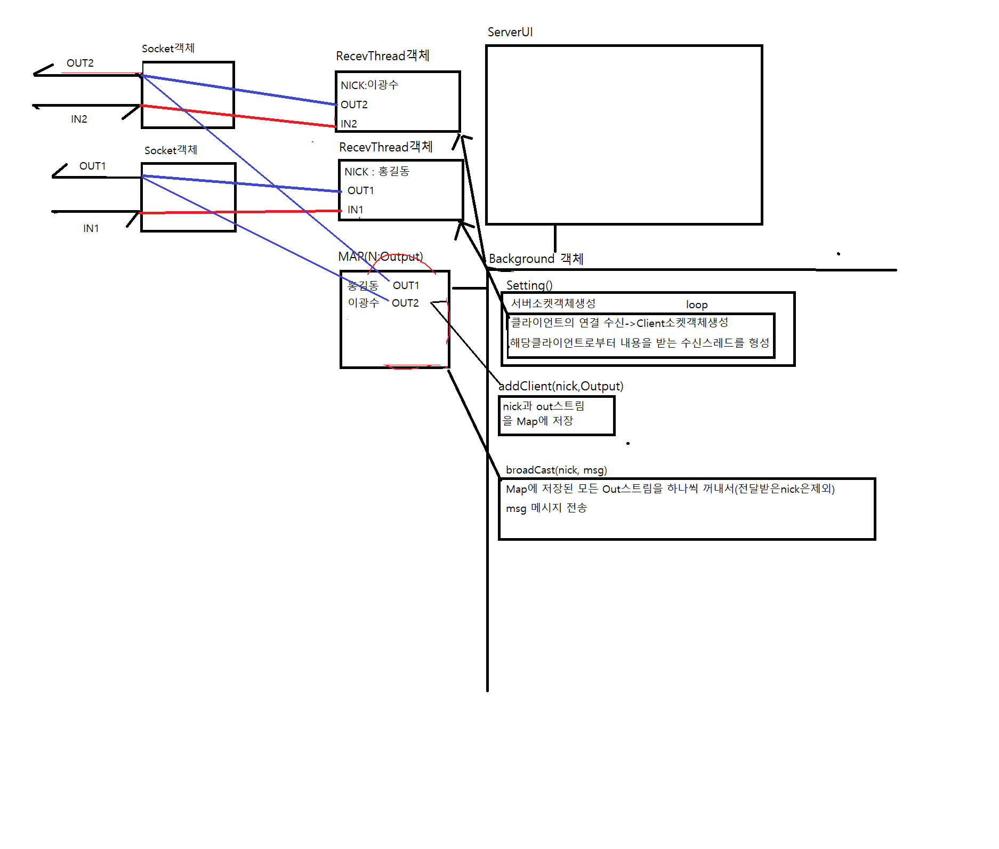

# Socket

- [소켓](#소켓)
- [1:1 통신](#11-통신)
- [송수신 스레드 분리](#송수신-스레드-분리)
- [GUI 채팅](#gui-채팅)
- [다중 접속 채팅](#다중-접속-채팅)

<br>

---

### 소켓

> 소켓(Socket)은 네트워크로 연결된 두 프로그램이 데이터를 주고받는 끝점이다. IP 주소로 컴퓨터를, 포트 번호로 프로그램을 찾는다. 서버는 `ServerSocket(포트)`로 포트를 열고 `accept()`로 접속을 기다리며, 클라이언트는 `Socket(서버 주소, 포트)`로 접속한다. `127.0.0.1`은 내 컴퓨터를 뜻한다.

<br>

```java
// 서버
ServerSocket server = new ServerSocket(7000);
Socket client = server.accept();    // 접속할 때까지 멈춤
DataOutputStream dout = new DataOutputStream(client.getOutputStream());
dout.writeUTF("WELCOME");

// 클라이언트
Socket server = new Socket("127.0.0.1", 7000);
DataInputStream din = new DataInputStream(server.getInputStream());
String recv = din.readUTF();        // 데이터가 올 때까지 멈춤(Blocking)
```

<br>

<span style="color:brown">`writeUTF`로 보내면 `readUTF`로 짝을 맞춰 받아야 한다. 다른 컴퓨터와 통신하려면 `127.0.0.1` 대신 그 컴퓨터의 IP로 바꾼다.</span>

<br>

- 예제 코드: [환영 메시지 서버](../JAVA03/src/Ch09Socket/C01WelcomeServer.java)
- 예제 코드: [환영 메시지 클라이언트](../JAVA03/src/Ch09Socket/C01WelcomeClient.java)

---

### 1:1 통신

> 서버와 클라이언트가 번갈아 `writeUTF`와 `readUTF`로 메시지를 주고받는 양방향 통신이다. 한쪽이 `q`를 보내면 종료한다. 단점은 상대가 보내기를 기다리는 동안 입력할 수 없고 `readUTF`가 멈춰 있는 동안 다른 일을 못 한다는 것이다.

<br>

- 예제 코드: [1:1 채팅 서버](../JAVA03/src/Ch09Socket/C02ChatServer.java)
- 예제 코드: [1:1 채팅 클라이언트](../JAVA03/src/Ch09Socket/C02ChatClient.java)

---

### 송수신 스레드 분리

> 보내기와 받기는 모두 입력이나 수신을 기다리며 멈추므로 스레드를 나눠 동시에 처리한다. 수신 스레드는 `readUTF`를 반복하고 송신 스레드는 키보드 입력을 받아 `writeUTF`를 반복한다. 메인 스레드는 `join()`으로 두 스레드가 끝나기를 기다린 뒤 자원을 닫는다.

<br>

- 예제 코드: [서버 메인](../JAVA03/src/Ch11ThreadChat/ServerMain.java)
- 예제 코드: [서버 수신 스레드](../JAVA03/src/Ch11ThreadChat/ServerRecvThread.java)
- 예제 코드: [서버 송신 스레드](../JAVA03/src/Ch11ThreadChat/ServerSendThread.java)
- 예제 코드: [클라이언트 메인](../JAVA03/src/Ch11ThreadChat/ClientMain.java)
- 예제 코드: [클라이언트 수신 스레드](../JAVA03/src/Ch11ThreadChat/ClientRecvThread.java)
- 예제 코드: [클라이언트 송신 스레드](../JAVA03/src/Ch11ThreadChat/ClientSendThread.java)

---

### GUI 채팅

> 화면(Swing)과 소켓을 합친 1:1 채팅이다. 화면 클래스가 소켓 연결과 송신(엔터 입력)을 맡고, 수신 스레드가 받은 메시지를 대화 영역에 출력한다. 수신 스레드에 화면 객체를 넘겨 `area.append`로 출력한다.

<br>

- 예제 코드: [서버 화면](../JAVA03/src/Ch12ChatGui/ServerUI.java)
- 예제 코드: [서버 수신 스레드](../JAVA03/src/Ch12ChatGui/ServerRecvThread.java)
- 예제 코드: [클라이언트 화면](../JAVA03/src/Ch12ChatGui/ClientUI.java)
- 예제 코드: [클라이언트 수신 스레드](../JAVA03/src/Ch12ChatGui/ClientRecvThread.java)

---

### 다중 접속 채팅

> 여러 클라이언트가 동시에 접속하는 채팅이다. `ServerBackground`가 서버 소켓에서 접속을 계속 받아, 접속마다 수신 스레드를 만든다. 접속자 목록은 닉네임을 키로, 해당 접속자에게 보내는 출력 스트림을 값으로 가진 `Map`에 저장하고, 한 명이 보낸 메시지를 목록의 다른 접속자에게 전달한다(브로드캐스트).

<br>

<aside>

처음 접속한 클라이언트는 닉네임을 먼저 보내고, 서버의 수신 스레드가 그 닉네임으로 목록에 등록한다. 이후 받은 메시지는 보낸 사람을 제외한 모든 접속자에게 전달한다.

</aside>

> 접속마다 Socket 객체와 수신 스레드(RecvThread) 객체가 만들어지고, 닉네임과 출력 스트림이 Map 에 저장되며, 메시지가 오면 Background 객체가 Map 의 모든 출력 스트림으로 전달하는 구조이다.

<br>



<br>

- 예제 코드: [채팅 구조 그림](../JAVA03/src/Ch13ChatMulti/ChatStructure.png)
- 예제 코드: [서버 화면](../JAVA03/src/Ch13ChatMulti/ServerUI.java)
- 예제 코드: [서버 백그라운드](../JAVA03/src/Ch13ChatMulti/ServerBackground.java)
- 예제 코드: [서버 수신 스레드](../JAVA03/src/Ch13ChatMulti/ServerRecvThread.java)
- 예제 코드: [클라이언트 화면](../JAVA03/src/Ch13ChatMulti/ClientUI.java)
- 예제 코드: [클라이언트 수신 스레드](../JAVA03/src/Ch13ChatMulti/ClientRecvThread.java)

---

### Link
[Java Sockets](https://docs.oracle.com/javase/tutorial/networking/sockets/index.html)
